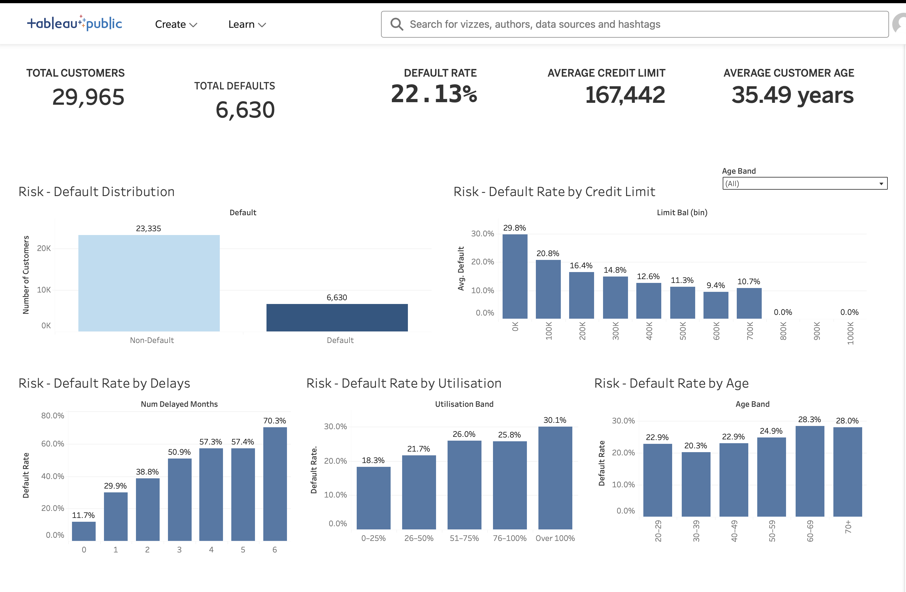

# Credit Risk Analytics & Loan Default Prediction

An end-to-end machine-learning project analysing customer credit behaviour and predicting the likelihood of future default.

## Project Overview

Credit risk is a major consideration for financial institutions when assessing lending decisions. This project explores historical credit-card customer data to identify patterns associated with default and develops machine-learning models for predicting customers at elevated risk.

The project covers the complete analytical workflow from exploratory data analysis and feature engineering through to model development and evaluation.

## Project Structure

- `01_data_understanding.ipynb` — exploratory data analysis and identification of credit-risk patterns
- `02_data_preparation.ipynb` — data cleaning, feature engineering and train/test preparation
- `03_modelling.ipynb` — machine-learning development and model evaluation
- `04_project_summary.ipynb` — project findings and final conclusions
- `credit_risk_random_forest.pkl` — trained Random Forest model

## Features Engineered

Additional indicators were developed from the original customer data, including:

- Number of delayed repayment months
- Maximum repayment delay
- Average bill amount
- Average payment amount
- Credit utilisation
- Payment-to-bill ratio

## Machine Learning

Two classification algorithms were compared:

- Logistic Regression
- Random Forest

### Results

| Model | Accuracy | Precision | Recall | F1 Score | ROC-AUC |
|---|---:|---:|---:|---:|---:|
| Logistic Regression | 74.42% | 44.31% | 60.78% | 51.26% | 75.28% |
| Random Forest | 76.72% | 47.94% | 60.56% | 53.52% | 77.57% |

Random Forest achieved the strongest overall performance with approximately **76.7% accuracy** and **0.78 ROC-AUC**.

## Key Findings

Repayment behaviour was among the strongest indicators of credit risk. Important features included maximum repayment delay, recent repayment status and the number of months in which repayments were delayed.

Credit utilisation and historical payment amounts also contributed to the model's predictions.

## Tools & Technologies

- Python
- pandas
- NumPy
- scikit-learn
- Matplotlib
- Jupyter
- Machine Learning
- Exploratory Data Analysis
- Feature Engineering

## Model Evaluation

Performance was assessed using:

- Accuracy
- Precision
- Recall
- F1 Score
- ROC-AUC
- Confusion Matrix
- ROC Curve
- Feature Importance

## Limitations

This project is an analytical prototype and should not be interpreted as a production lending decision system.

A real-world financial application would require additional validation, fairness and bias testing, explainability, regulatory review, security controls and ongoing model monitoring.

## Conclusion

This project demonstrates how data analytics and machine learning can be applied to a practical financial risk problem, progressing from raw customer data through analysis and feature engineering to predictive modelling and evaluation.

## Interactive Credit Risk Dashboard — Tableau

Developed and published an interactive Tableau dashboard to visualise credit default patterns across 29,965 customer records.

### Portfolio Overview
- **Total Customers:** 29,965
- **Total Defaults:** 6,630
- **Default Rate:** 22.13%
- **Average Credit Limit:** NT$167,442
- **Average Customer Age:** 35.49 years

### Dashboard Features
- Default versus non-default customer distribution
- Default rates across credit-limit bands
- Analysis of repayment delays and default risk
- Credit utilisation and associated default rates
- Default rates across customer age groups
- Interactive age-band filtering across the dashboard

### Key Findings
Previous repayment delays were strongly associated with higher default rates. Customers with higher credit utilisation also generally experienced higher observed default rates.

These findings demonstrate associations within the dataset rather than causal relationships.

### View the Interactive Dashboard

[Explore the Credit Risk Portfolio Dashboard on Tableau Public](https://public.tableau.com/app/profile/yunus.ali5178/viz/CreditRiskPortfolioDashboard/CreditRiskPortfolioDashboard)

This dashboard complements the Python machine-learning analysis, where Logistic Regression and Random Forest models were developed and evaluated for credit default prediction.
